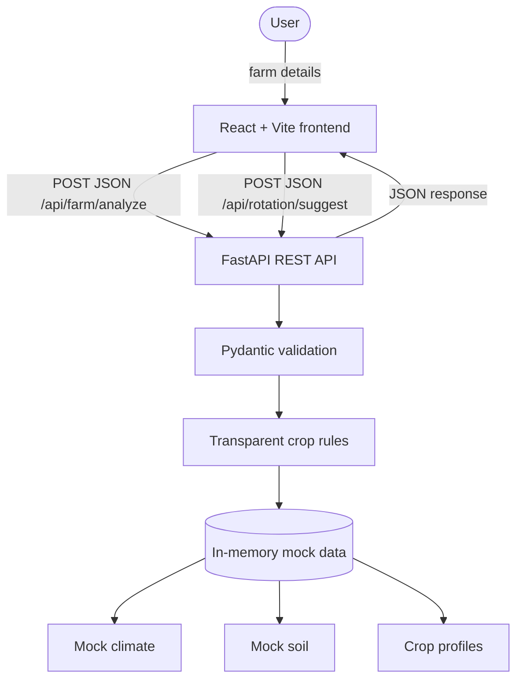

# Field Shift — Phase 1 Architecture Demo

Field Shift is a lightweight crop-rotation proof of concept for NASA Space Apps 2026. It exists to make the proposed client–server architecture tangible: enter a few farm values in React, send JSON to FastAPI, and render rule-based sample recommendations.

> **Demo / Mock Data:** Every climate, soil, suitability, and risk value is illustrative. Scores are not scientifically validated forecasts or farming advice.

## Architecture



The two processes are intentionally independent. The browser uses the Fetch API in `frontend/src/services/api.js`; CORS in `backend/main.py` always permits local Vite origins and can add production origins from environment configuration. There is no database, authentication, external service, AI, or server-side state.

## What happens when Analyze is clicked

1. React holds the form values in local component state.
2. `analyzeFarm()` sends the same validated JSON payload to both `POST /api/farm/analyze` and `POST /api/rotation/suggest` in parallel.
3. FastAPI validates the payload with `FarmInput` (latitude/longitude ranges and positive field area).
4. The analysis service selects deterministic mock soil and climate profiles, then applies readable water, pH, crop-family, and repeat-crop rules.
5. FastAPI serializes typed response models to JSON. React renders climate, soil, ranked crops, risks, and a three-season plan.

The frontend also calls `GET /api/health` on load and shows the API connection state in the navigation bar. Interactive API documentation is available at `http://localhost:8000/docs`.

## Run locally

Requirements: Python 3.10+ and Node.js 18+.

### 1. Start FastAPI

```bash
cd field-shift/backend
python -m venv .venv
# Windows PowerShell
.venv\Scripts\Activate.ps1
pip install -r requirements.txt
uvicorn main:app --reload --port 8000
```

The API will be available at `http://localhost:8000`. Check `http://localhost:8000/api/health`.

### 2. Start React

In a second terminal:

```bash
cd field-shift/frontend
npm install
npm run dev
```

Open `http://localhost:5173`. The form starts with the sample values from the brief, so you can click **Analyze field** immediately.

To point the client at a different backend, create `frontend/.env.local`:

```text
VITE_API_URL=http://localhost:8000/api
```

If `VITE_API_URL` is not set, local development still defaults to `http://localhost:8000/api`.

## GitHub Pages frontend + deployed backend configuration

The Pages workflow only deploys the frontend bundle. It does **not** run FastAPI. The page can be deployed before the backend is configured, but API actions will show the backend as offline until a public URL is supplied.

### 1) Configure frontend API URL for Pages builds

Set a GitHub **repository variable** (or environment variable used by the workflow) named:

- `VITE_API_URL`

Use the full deployed FastAPI API base URL including `/api`, for example:

```text
https://your-fastapi-host.example.com/api
```

The single `.github/workflows/deploy-pages.yml` workflow passes this variable into `npm run build`. If the variable is missing, the workflow emits a warning and still deploys the frontend so the interface remains reviewable.

### 2) Configure backend CORS for GitHub Pages origin

Set this environment variable on your FastAPI host:

- `FIELD_SHIFT_CORS_ORIGINS`

This is a comma-separated list of additional allowed origins (no wildcards), for example:

```text
FIELD_SHIFT_CORS_ORIGINS=https://xo5u.github.io
```

or multiple origins:

```text
FIELD_SHIFT_CORS_ORIGINS=https://xo5u.github.io,https://your-custom-domain.example.com
```

The backend always keeps local development origins:

- `http://localhost:5173`
- `http://127.0.0.1:5173`

## API endpoints

| Method | Path | Purpose |
|---|---|---|
| GET | `/api/health` | Confirm the backend is running |
| GET | `/api/crops` | Inspect sample crop requirements |
| POST | `/api/farm/analyze` | Return mock environment, crop fit, and risk data |
| POST | `/api/rotation/suggest` | Return a mock three-season rotation |

Example request body:

```json
{
  "latitude": 32.22,
  "longitude": 35.26,
  "area_dunams": 10,
  "available_water_m3": 500,
  "previous_crop": "wheat"
}
```

## Where real integrations go later

Keep external data providers behind small backend adapters; the React contract does not need to change.

- **NASA POWER:** add `backend/services/nasa_power.py` to fetch location-based temperature, rainfall, solar radiation, and related climate values. Replace `climate_for()` in the analysis service with this adapter.
- **SoilGrids:** add `backend/services/soilgrids.py` for coordinates-to-soil properties. Replace `soil_for()` while keeping the existing `SoilData` response shape.
- **FAO:** add `backend/services/fao.py` to source crop calendars, water requirements, and agronomic reference values. Normalize them into crop profiles before rules run.

Those adapters should handle caching, timeouts, provider errors, units, attribution, and data freshness. This phase deliberately does none of that so teammates can inspect the communication boundary without production complexity.

## Project map

```text
field-shift/
├── frontend/
│   ├── src/components/     # map, mock labels, result dashboard
│   ├── src/services/api.js # all browser-to-API calls
│   └── src/App.jsx         # form state and analyze workflow
├── backend/
│   ├── routes/             # thin HTTP endpoint handlers
│   ├── schemas/            # Pydantic request/response contracts
│   ├── services/           # transparent rules and orchestration
│   ├── mock_data/          # replaceable in-memory datasets
│   └── main.py             # app setup and CORS origin config
└── README.md
```
